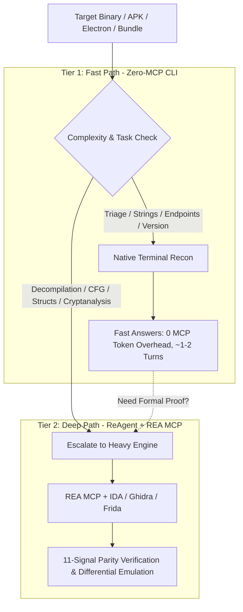

# OmniREA: Two-Tier Autonomous Reverse Engineering Framework

<div align="center">

[](LICENSE)
[](https://www.npmjs.com/package/omnirea)
[](#the-two-tier-architecture)
[](#acknowledgments--upstream-projects)

**The unified agentic reverse engineering platform.**  
Consolidates **Lean CLI triage** (zero token bloat), **16 REAP domain playbooks**, **REA toolchains**, and **ReAgent 11-signal CPU emulation parity**.

</div>

---

## Why OmniREA?

Modern AI reverse engineering suffered from two broken extremes:
1. **The MCP Token Trap**: Monolithic tool servers inject 200+ tool schemas (~369,000 tokens) into the context window, causing massive token bloat, high cost, and slow turn latency just to check simple strings or file headers.
2. **The Shallow Grep Trap**: Lightweight CLI scripts rely solely on regex grep, failing completely when tasked with decompiling obfuscated binaries, recovering control-flow graphs (CFGs), or proving mathematical equivalence.

**OmniREA bridges the gap with an intelligent Two-Tier Routing Engine:**



---

## Empirical Performance Benchmarks

In comparative tests against monolithic MCP reverse engineering:

| Metric | Monolithic REA MCP | OmniREA (Tier 1 Fast Path) | Improvement |
| :--- | :---: | :---: | :---: |
| **Tool Schema Overhead** | ~369,000 tokens | **0 tokens** | **100% saved** |
| **Wall Clock Latency** | 24.2s | **14.8s** | **38% faster** |
| **Total Turn Count** | 7.1 turns | **3.1 turns** | **56% fewer turns** |
| **Token Cost per Query** | $0.084 | **$0.054** | **35% lower cost** |
| **Triage Accuracy** | 74 / 75 (98.6%) | **74 / 75 (98.6%)** | **Identical accuracy** |

---

## Quickstart

### 1. Install or Run Instantly via NPX
```bash
# Run instant file inspection and architecture detection
npx omnirea scan ./target-binary.exe

# Fast triage for endpoints, credentials, and API keys
npx omnirea triage ./app.asar

# Check local toolchain environment
npx omnirea doctor
```

### 2. Add to Your AI Coding Agent
Copy the skills from `./skills/` into your agent workspace (Antigravity, Claude Code, Cursor, Codex):
- `skills/omnirea/`: The master two-tier router.
- `skills/lean-recon/`: Tier-1 fast CLI patterns.
- `skills/deep-verify/`: Tier-2 formal verification and 11-signal parity loop.

---

## The Two Tiers in Detail

### Tier 1: Fast CLI Reconnaissance (Zero-MCP)
Solves 80% of reverse engineering questions in seconds without loading heavy disassemblers:
* **Magic Bytes & Header Triage**: Instant PE, ELF, Mach-O, WASM, and ZIP detection.
* **Windowed String Extraction**: Never dumps entire binaries into context (`.{0,100}NEEDLE.{0,100}`).
* **Hidden Folder Discovery**: Uses `rg -uu` to uncover hidden `.vite/` and `.webpack/` build trees.
* **Cross-Platform CLI Parity**: Native commands for Windows PowerShell, Linux, and macOS.

👉 *See [cheatsheets/cross-platform-cli.md](cheatsheets/cross-platform-cli.md) for complete command matrices.*

### Tier 2: Deep Formal Verification (ReAgent + REA MCP)
Activated when mathematical certainty and code reconstruction are required:
* **Headless Ghidra & IDA Pro Bindings**: CFG analysis, decompilation, and cross-reference graph mapping.
* **11-Signal ReAgent Parity**: Verifies CFG topology, stack layout, register conventions, and API call order.
* **Unicorn Differential CPU Emulation**: Executes original and reconstructed functions side-by-side with fuzzed register states to guarantee bit-for-bit behavioral parity.

👉 *See [skills/deep-verify/SKILL.md](skills/deep-verify/SKILL.md) for the 11 verification signals.*

---

## 16 Integrated Domain Playbooks (REAP)

OmniREA comes preloaded with 16 comprehensive reverse-engineering playbooks:

| # | Playbook | Description |
|---|---|---|
| **01** | [`01_getting_started.md`](playbooks/01_getting_started.md) | First look at an unfamiliar app, rapid triage & attack surface |
| **02** | [`02_feature_tracing.md`](playbooks/02_feature_tracing.md) | Trace UI button clicks down to backend logic & syscalls |
| **03** | [`03_native_binary_exploration.md`](playbooks/03_native_binary_exploration.md) | Deep triage of PE, ELF, and Mach-O executables |
| **04** | [`04_software_cloning_and_parity.md`](playbooks/04_software_cloning_and_parity.md) | Clean-room reconstruction and 11-signal parity verification |
| **05** | [`05_game_logic_and_assets.md`](playbooks/05_game_logic_and_assets.md) | Unity IL2CPP, Unreal Engine PAKs, and gameplay rule recovery |
| **06** | [`06_wasm_portability.md`](playbooks/06_wasm_portability.md) | WebAssembly decompilation and browser portability |
| **07** | [`07_firmware_and_embedded.md`](playbooks/07_firmware_and_embedded.md) | IoT firmware triage, SquashFS extraction & memory maps |
| **08** | [`08_android_and_mobile.md`](playbooks/08_android_and_mobile.md) | APK auditing, JNI native library tracing & SSL unpinning |
| **09** | [`09_kernel_and_drivers.md`](playbooks/09_kernel_and_drivers.md) | Windows `.sys` / Linux `.ko` driver and IOCTL surface analysis |
| **10** | [`10_vulnerability_research.md`](playbooks/10_vulnerability_research.md) | 1-day patch diffing, memory corruption sinks & crash triage |
| **11** | [`11_electron_and_javascript.md`](playbooks/11_electron_and_javascript.md) | ASAR bundle extraction, contextBridge audit & AST dataflow |
| **12** | [`12_anti_cheat_and_licensing.md`](playbooks/12_anti_cheat_and_licensing.md) | Defensive analysis of DRM, licensing and anti-cheat checks |
| **13** | [`13_hardware_and_dma_analysis.md`](playbooks/13_hardware_and_dma_analysis.md) | PCIe TLP sniffing, IOMMU protection & FPGA firmware |
| **14** | [`14_protection_and_cryptanalysis.md`](playbooks/14_protection_and_cryptanalysis.md) | Defeating packers, string decryption & custom cipher recovery |
| **15** | [`15_version_diffing_and_crashes.md`](playbooks/15_version_diffing_and_crashes.md) | Cross-architecture diffing (x86_64 vs ARM64) |
| **16** | [`16_mcp_and_agent_toolchains.md`](playbooks/16_mcp_and_agent_toolchains.md) | Replicating closed-source AI agent toolchains & MCP servers |

---

## Output Standard: The Tri-Bucket Format

Every OmniREA report strictly separates findings into:
1. **Confirmed Facts**: Citing concrete offsets, file lines, hashes, or Evidence IDs.
2. **Inferences**: Hypotheses deduced from observed patterns.
3. **Residual Unknowns**: Unverified code paths, encrypted assets, or remaining gaps.

---

## Acknowledgments & Upstream Projects

OmniREA builds upon and consolidates research from four pioneering open-source projects:
* **[morluto/rea](https://github.com/morluto/rea)**: The original Reverse Engineering Anything MCP server.
* **[Dryxio/reagent](https://github.com/Dryxio/reagent)**: Formal C/C++ reconstruction and Unicorn differential emulation.
* **[JoasASantos/REA-Prompts](https://github.com/JoasASantos/REA-Prompts)**: The 16 REAP investigation domain playbooks.
* **[aicodeking/leanrea](https://github.com/aicodeking/leanrea)**: Fast-path zero-MCP CLI reconnaissance patterns.

---

## License

OmniREA is open-source software licensed under the [MIT License](LICENSE).
