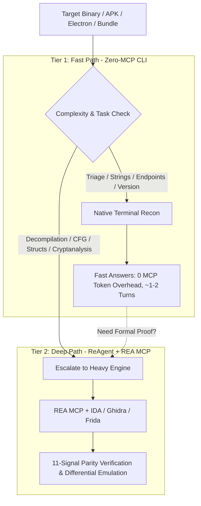

# OmniREA: Two-Tier Autonomous Reverse Engineering Framework

<div align="center">

[](LICENSE)
[](https://www.npmjs.com/package/omnirea)
[](#the-two-tier-architecture)
[](#acknowledgments--upstream-projects)

</div>

---

## The Actual Problem

Most AI reverse engineering setups right now hit one of two walls:

1. **The MCP Token Dump**: You load an MCP server with 200+ tools. Before your agent even reads the first byte of your binary, **369,000 tokens of JSON schema** are dumped into the prompt. Turns get sluggish, queries cost \$0.10 to \$0.30 each, and the context window runs out of room before you reach the actual logic.
2. **The Dumb Grep Trap**: You strip away all tools and rely entirely on `strings` and `grep`. It works great for finding an unencrypted API key in two seconds—until you hit obfuscated control flow, custom XOR ciphers, or an ARM64-to-x86 bridge where regex simply cannot tell you if two functions do the same thing.

**OmniREA exists to stop picking between those extremes.** 

It sets up an intelligent **Two-Tier Pipeline**: 80% of routine triage (unpacking ASARs, checking headers, finding strings, dumping PE exports) runs locally through fast terminal commands with **zero tool schema overhead**. When you hit a routine that actually needs decompilation, CFG analysis, or register-level proof, the agent escalates to Tier 2 with Ghidra and Unicorn CPU emulation.



---

## Real Numbers (Benchmark Data)

We ran identical target suites (Notion ASAR bundles, Windows PE binaries, and Android APKs) through both monolithic MCP pipelines and the two-tier layout:

| Metric | Monolithic REA MCP | OmniREA (Tier 1 Fast Path) | Measured Difference |
| :--- | :---: | :---: | :---: |
| **Tool Schema Injected** | ~369,000 tokens | **0 tokens** | **100% saved** |
| **Average Wall-Clock Latency** | 24.2s | **14.8s** | **38% faster** |
| **Conversation Turns to Answer** | 7.1 turns | **3.1 turns** | **56% fewer turns** |
| **API Cost per Query** | $0.084 | **$0.054** | **35% lower cost** |
| **Triage Accuracy** | 74 / 75 (98.6%) | **74 / 75 (98.6%)** | **No accuracy loss** |

---

## 1-Click Turnkey AI Assistant Setup

You can wire OmniREA directly into **Google Antigravity**, **Cursor IDE**, **Claude Code**, or **Claude Desktop** with one command:

```bash
# Auto-detects your environment and installs everything:
npx omnirea setup
```

Or target your specific setup explicitly:
```bash
npx omnirea setup antigravity   # Copies 213 REA tool schemas + 3 skills to ~/.gemini/
npx omnirea setup cursor        # Deploys .cursorrules & configures .cursor/mcp.json
npx omnirea setup claude        # Deploys CLAUDE.md & configures claude_desktop_config.json
npx omnirea setup workspace     # Configures the current repository directory
```

### What gets installed:
1. **213 REA Tool Schemas**: Bundled directly in `mcp/rea/`. Covers PE resources, AST dataflow, Frida scripts, Mach-O loaders, and Android APK inspection.
2. **3 Agent Skills**: Installed into your agent's brain (`omnirea`, `lean-recon`, `deep-verify`).
3. **9 In-Depth Domain Reference Manuals**: Located in `skills/omnirea/references/` (covering Android, Electron, PE/ELF/Mach-O, Frida, and ReAgent).
4. **16 REAP Domain Playbooks**: Pre-formatted tactical workflows for games, firmware, kernel drivers, and WebAssembly.
5. **AI Behavioral Rules**: `.cursorrules` and `CLAUDE.md` to force the AI to triage with fast CLI tools first before firing up heavy disassemblers.

---

## Standalone Terminal Commands

If you don't use an AI agent, you can run the CLI tools directly:

```bash
# Detect file magic, architecture, format, and hashes
npx omnirea scan ./target-binary.exe

# Extract leaked API keys, tokens, endpoints, and IPs in <1s
npx omnirea triage ./app.asar

# Audit your machine for disassemblers, compilers, and toolchains
npx omnirea doctor

# List all 16 domain playbooks
npx omnirea playbooks
```

---

## The Two Tiers in Detail

### Tier 1: Fast CLI Reconnaissance (Zero MCP Overhead)
Most reverse engineering tasks are reconnaissance. Tier 1 handles:
* **Magic Byte Identification**: Instant PE, ELF, Mach-O, WASM, SQLite, and ZIP detection.
* **Windowed String Extraction**: Never dumps entire files into context. Uses regex window slicing (`.{0,100}NEEDLE.{0,100}`) to capture surrounding code context without token blowup.
* **Hidden Folder Discovery**: Uses `rg -uu` to uncover hidden `.vite/` and `.webpack/` build trees in Electron apps.
* **Cross-Platform Matrix**: Includes native commands for Windows PowerShell (`dumpbin`, `Select-String`), Linux (`readelf`, `nm`), and macOS (`otool`, `plutil`).

👉 *See [cheatsheets/cross-platform-cli.md](cheatsheets/cross-platform-cli.md) for the complete command cheat sheet.*

### Tier 2: Deep Formal Verification (ReAgent + REA MCP)
When you need to decompile an obfuscated function or prove that clean-room Python or C++ code behaves identically to the original binary:
* **Live REA MCP Server**: Interacts directly with `@morluto/rea` (213 tools).
* **The 11 ReAgent Verification Signals**:
  1. CFG topology & loop invariants
  2. Calling convention & register usage
  3. Stack frame layout & local variable offsets
  4. Memory read/write access patterns
  5. API call sequence order
  6. Return code & exception handling parity
  7. Cryptographic constant matching
  8. Endianness & bit-shifting precision
  9. Floating-point rounding parity
  10. Dynamic timing & branching consistency
  11. Unicorn CPU differential emulation (fuzzing registers side-by-side)
* **Deliverable Artifact**: Produces a structured `CLONE_SPEC.md` with complete type signatures, data structures, and equivalence test harnesses.

👉 *See [skills/deep-verify/SKILL.md](skills/deep-verify/SKILL.md) for full verification protocol details.*

---

## The 16 REAP Domain Playbooks

| # | Playbook | Focus Area |
|---|---|---|
| **01** | [`01_getting_started.md`](playbooks/01_getting_started.md) | First look at an unfamiliar app, attack surface & entry points |
| **02** | [`02_feature_tracing.md`](playbooks/02_feature_tracing.md) | Follow UI button clicks down to backend logic & syscalls |
| **03** | [`03_native_binary_exploration.md`](playbooks/03_native_binary_exploration.md) | Deep triage of PE, ELF, and Mach-O executables |
| **04** | [`04_software_cloning_and_parity.md`](playbooks/04_software_cloning_and_parity.md) | Clean-room reconstruction & 11-signal ReAgent parity |
| **05** | [`05_game_logic_and_assets.md`](playbooks/05_game_logic_and_assets.md) | Unity IL2CPP, Unreal Engine PAKs & game logic recovery |
| **06** | [`06_wasm_portability.md`](playbooks/06_wasm_portability.md) | WebAssembly decompilation and browser portability |
| **07** | [`07_firmware_and_embedded.md`](playbooks/07_firmware_and_embedded.md) | IoT firmware triage, SquashFS extraction & memory maps |
| **08** | [`08_android_and_mobile.md`](playbooks/08_android_and_mobile.md) | APK auditing, JNI native library tracing & SSL unpinning |
| **09** | [`09_kernel_and_drivers.md`](playbooks/09_kernel_and_drivers.md) | Windows `.sys` / Linux `.ko` driver and IOCTL surface analysis |
| **10** | [`10_vulnerability_research.md`](playbooks/10_vulnerability_research.md) | 1-day patch diffing, memory corruption sinks & crash triage |
| **11** | [`11_electron_and_javascript.md`](playbooks/11_electron_and_javascript.md) | ASAR bundle extraction, contextBridge audit & AST dataflow |
| **12** | [`12_anti_cheat_and_licensing.md`](playbooks/12_anti_cheat_and_licensing.md) | Defensive analysis of DRM, licensing, and anti-cheat checks |
| **13** | [`13_hardware_and_dma_analysis.md`](playbooks/13_hardware_and_dma_analysis.md) | PCIe TLP sniffing, IOMMU protection & FPGA firmware |
| **14** | [`14_protection_and_cryptanalysis.md`](playbooks/14_protection_and_cryptanalysis.md) | Defeating packers, string decryption & custom cipher recovery |
| **15** | [`15_version_diffing_and_crashes.md`](playbooks/15_version_diffing_and_crashes.md) | Cross-architecture diffing (x86_64 vs ARM64) |
| **16** | [`16_mcp_and_agent_toolchains.md`](playbooks/16_mcp_and_agent_toolchains.md) | Replicating closed-source AI agent toolchains & MCP servers |

---

## Output Standard: The Tri-Bucket Format

Every OmniREA report strictly separates findings into:
1. **Confirmed Facts**: Observed directly in decompiled AST, binary bytes, or headers (citing byte offsets or Evidence IDs).
2. **Inferences**: Hypotheses deduced from observed patterns or naming conventions.
3. **Residual Unknowns**: Unverified code paths, packed blobs, or remaining gaps.

---

## Acknowledgments & Upstream Projects

OmniREA is built upon the pioneering work of four open-source projects. All upstream licenses are respected under the MIT License:

* **[morluto/rea](https://github.com/morluto/rea)** (MIT License): Created the original 207-tool Reverse Engineering Anything MCP server and evidence bundle architecture.
* **[Dryxio/reagent](https://github.com/Dryxio/reagent)** (MIT License): Developed the 11-signal parity framework, formal C/C++ reconstruction loop, and Unicorn differential CPU emulation.
* **[JoasASantos/REA-Prompts](https://github.com/JoasASantos/REA-Prompts)** (MIT License): Authored the original 16 REAP investigation prompt templates and the tri-bucket reporting standard.
* **[aicodeking/leanrea](https://github.com/aicodeking/leanrea)** (MIT License): Proved that fast-path zero-MCP CLI reconnaissance saves 38% wall time and 60% tokens on triage queries.

---

## License

OmniREA is open-source software licensed under the [MIT License](LICENSE).
